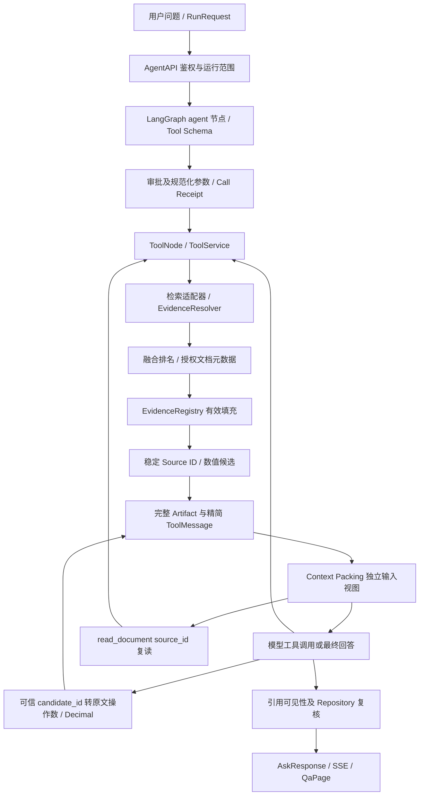

# Agentic RAG V2 全链路审计与第一批根因修复

日期：2026-11-01。审计起点：`408dbf1`，实现前本地和 origin 均为该提交，工作区干净。开发分支 `codex/v2-document-repository`。

## 审计范围和证据分类

本次实际阅读 runtime/context/evidence/citations/checkpoint/api/state，retrieval service/fusion/tools/evidence/calculations，document_structure/chunk_builder，前端 QaPage 和现有回归及两份历史评测。没有改造 Repository、MinerU、Dify、BM25/Vector/RRF 算法、主 Agent 图或生产数据库。

- **已复现缺陷**：有效候选填充被前 N 个无效/重复候选截断；文档聚合丢失已验证名称；尾部弹出装箱丢弃后面的可容纳证据；长目录使有效结果变为 output_budget。
- **已证实性能问题**：基线使用元数据去重和上下文视图后，历史 10 题仍累计 650,605 tokens，38 次工具调用；本次不把较短观察自动等同于总体成本降低。
- **功能缺口**：Source 不能直接受控复读；重复数字只有模型手写偏移入口。已有校验正确拒绝，但缺少模型可可靠使用的恢复/选择协议。
- **潜在风险/边界**：启发式 tokenizer、同步 SQLite 读取阶段的时间预算非抢占、复杂表格单位/列含义不能自动推断、同模型内容选择不保证正确性、SSE 队列背压。没有把这些未经复现的风险说成已修复故障。

## 真实数据流与逐节点检查



| 节点 / 文件函数 | 输入 → 输出 | 限制与失败行为 | 权限/恢复/持久化/SSE | 覆盖情况 |
|---|---|---|---|---|
| AgentAPI.prepare / QaPage | RunRequest → scopes、ExecutionBudget、SSE | 问题 4K、配置预算；监督 Agent 保留 legacy | owner/Agent/KB 每次复核；前端只显示最终校验结果；状态接口不暴露 checkpoint | 原 REST/前端/审批测试保留 |
| runtime.agent/model_call | messages + catalog → AIMessage | 12 次迭代、120K 累计 token、2K 单次输出；失败有 stop_reason | Provider usage 替换预估；独立视图不改 add_messages；配对保持 | 原预算、usage、配对测试 |
| approval/tool_wrapper | 原工具参数 → 规范化参数及 receipt | 调用/检索/超时预算；不重放 uncertain 调用 | 同规范参数进入审批、消费和幂等绑定；新增可选默认字段不破坏旧绑定 | 新 candidate 审批、并行复读及原跨进程测试 |
| ToolService/search/Resolver | RetrievalRequest → verified Evidence + documents | 原候选/原文范围/超时上限；外部映射严格定位 | KB/ACL/版本二次复核；不信任远端标题/编号 | 原向量映射、ACL、历史版本测试 |
| fusion + service | 已验证 Evidence → 文档候选 | 排名保持；首次含 filename/name、标准号/年份、version、score/rank | 元数据取授权 snapshot；撤权文档移除；历史元数据标 current_source_metadata | 新相似名称/年份、读回及撤权测试 |
| Registry.collect/load | 候选 → refs/snippets | 最多扫描默认 100、硬上限 200，最多 5 秒；独立有效注册额度 | 原文/版本/hash 校验；无效前缀不再占有效额度；重复不新建 Source | 新 Red→Green、预算/ACL/换版/全无效测试 |
| Source/数字候选 | 已验证 refs → S 编号 / num ID | 数字扫描最多 1000 个、首屏 12 个；不抽标签属性 | ID 绑定 run_id、evidence_id、偏移、原文字面；state/checkpoint 保存 | 新重复值、单位、坐标、伪造/隐藏/跨 run 测试 |
| observation/packing | 完整 Artifact → 模型观察 | 搜索16K、导航6K、精读24K；独立元数据额度；整片装箱 | 未入模型的证据无引用资格；遗漏有导航；Artifact 不删除 | 长目录、首条过大、多样性、表格原子测试 |
| Context Packing | checkpoint 消息 → 独立工作视图 | 原字符/window/累计预算保持；旧长观察只变导航 | 保留 ToolCall/ToolMessage；旧 Source 不自动复活；SSE 只发计数 | 原上下文/撤权及新9144机制复现 |
| Source 复读 | read_document(kb,source_id) → 原证据 | 仅当前 Run 注册 Source；可分页数字候选 | load 再验证 ACL/版本/locator/hash；原文进入新消息后才可引用；REST 无 run context 拒绝 | 删除/换版/ACL/hash、跨 KB/run、跨进程审批 |
| Calculate | candidate_id 或旧值/偏移 → Decimal 回执 | 原精度34位、数值边界/单位/维度规则不变 | 可见 candidate 服务端重新抽取比对，再转精确旧参数；审批同 canonical | 重复数值及单位、override/foreign/hidden 拒绝 |
| 引用/返回 | S claims → validated AskResponse | 格式/可见性/原文定位；不是语义正确性判定 | 最终再次读权限/版本；旧 API 和前端仍不信任模型 URL | 原引用/URL/页面/撤权回归 |

## 问题矩阵、复现和修复

| 优先级 / 问题 | 旧行为与根因 | 实测 Red | 新逻辑 / 关联链路 | 剩余边界 |
|---|---|---|---|---|
| P1 A 有效证据填充 | collect 对 candidates[:limit] 验证，坏候选或重复消耗前缀 | 无效前4条后2有效：0/2；重复前4条后另一有效：1/2 | 顺序扫描，注册满有效额度才停；examined/rejected/duplicate/registered/budget_exhausted；load/Source/并行不变 | 仍受100候选/5秒预算；不是无限全量验证 |
| P1 B 文档辨识 | fusion 聚合只放ID/score/数组，observation允许name但上游根本没提供 | document_name KeyError | fusion保留Evidence名称，service从授权snapshot补filename/标准标题编号年份，rank/version；重复仍保留简短名称 | 标准元数据缺失保持null；历史元数据不是伪造版本快照 |
| P1 C 工具装箱 | pop尾部，超大首条导致后续短证据也被删；长目录占满后整体error | 长目录+有效片段变error；20K首条+短次条最终空 | 元数据独立至多3K/20%；完整片段有界first-fit；搜索优先首排名及不同文档；被省略Source可复读 | 不声称优化了语义相关性模型；搜索原排序不变，仅观察子集选择 |
| P1 D 证据恢复 | pack只有Locator导航，需要模型手动重建读取参数；9144引用hidden被正确拒绝 | read_document(source_id) Schema不支持，无收据 | 复用现有读取工具，新增source_id受控分支；同run map+load+scope、审批/收据；REST无context失败 | S1是run-local别名，不是跨run句柄；跨run不会取回旧对象 |
| P1 E 数值定位 | 重复数值/单位迫使模型猜偏移，错误身份或偏移被拒绝 | 两个42 USD不存在numeric_candidates | 限定原文抽取→num ID→可见性→服务端重验→规范化旧Decimal输入；旧接口保留 | 不推断单位、年份语义或operation；复杂/转义表格可缺坐标；不是自动答案验证 |

基线 `408dbf1` 上新增 7 个 Red 测试：**7 failed，2.32 秒**；修改后同名同断言 **7 passed，2.05 秒**。文件 `tests/test_agent_root_causes.py`。这些使用真实 SQLite Repository、Tantivy、LangGraph ToolNode；模型是确定性脚本，不冒充真实模型验收。

对应测试：`test_registration_fills_after_rejections_and_duplicates`（两参数）、`test_document_candidates_have_verified_names`、`test_oversize_metadata_does_not_evict_valid_evidence`、`test_oversized_first_evidence_does_not_starve_short_second`、`test_source_reread_keeps_identity_and_receipt`、`test_repeated_numbers_can_use_trusted_candidate_id`。

新增年份元数据测试最初误以为标准年份 Schema 是字符串；实际 Source 为整数，已改为与真实 Repository 字段类型比较。这是新测试编写错误，不改变产品行为或旧测试，未算入7项Red缺陷。

## 安全接口契约与兼容性

### 证据复读

复用 `v2.read_document`，接受 `{knowledge_base_id,source_id,number_start?}`。运行时从自有 LangGraph state 查 Source，拒绝未知/跨KB/冲突document_id/version_id。`EvidenceRegistry.load` 重验原文 hash、scope digest 和 locator；随后规范化 document/version 与 Source 共同绑定审批/收据。普通 REST 没有 `evidence_context` 不能使用 Source 别名；不会接受请求自带 state 或 run_id。跨线程所有权仍由 ExecutionStore.thread/AgentAPI.owned 保证。

复读是重新读取原文，不重放旧工具。表格行证据的结构伴随数据保存在 ref 中并在复读保留。只有 observe 入模型并由 agent 的实际输入集合确认后才恢复可见性；最终 citations.validate 再读 Repository。导航只是导航。

### 数值候选

`numeric_candidates` 随可见证据给出 candidate_id/source_id/evidence_id、raw_text、start/end、紧邻可确认单位及单位偏移、可确认row/column、headers、row_context、短原文上下文、verification_status。候选由精确片段产生，ID包含当前run；candidate_id不是另一个事实库。

Calculate 兼容旧value/evidence_id/source_id接口，新增candidate_id。服务端要求candidate ID和所属证据均在当前模型可见集合中，重新从Repository加载片段并重新抽取，比对完整候选后转换为原精确值/偏移/单位参数。任何模型覆盖真实值、单位或偏移都会拒绝。仍使用原Decimal精度、合法数值边界和单位匹配；没有根据答案猜操作数。

表格坐标仅在现有HTML/Markdown解析与原文区间能对应时返回；JSON投影仅在字符串没有转义导致偏移歧义时建立值区域。HTML标签属性不会作为操作数。已知表头原文保留；没有明确单位不从表名/年份猜单位。千/百万缩放和operation选择仍需模型理解，未自动推导。

### 观察选择与截断指标

搜索在原排名首证据后优先不同文档，再考虑同文档更多证据；候选不足/无效不会改变底层BM25/Vector/RRF排名。精读保持完整片段不任意改写文字。表格行与结构元数据不可分，放不下时导航复读而不制造残缺可信表。

新指标区分 result_partial、evidence_content_truncated、candidate_selection、observation_budget_truncated，以及注册的examined/registered/rejected/duplicate/budget_exhausted。Metadata首屏或候选筛选不是原文被严重截断。每调用保留前后字符数、计数和原因；原始Artifact保留，日志/SSE指标不含原文。

### Checkpoint、审批、前端

Graph节点、ToolNode、add_messages与owner/thread/run绑定不变。新增state字段对旧checkpoint默认空；新run重置数字候选和Source映射。规范参数排除新增的空candidate_id/source_id和默认number_start，防止旧审批/receipt仅因Schema加字段而失配。新增跨进程Source复读及并行复读/数值审批回归。catalog仍为18工具，旧REST及前端AskResponse字段保持兼容；前端不将引用校验等同事实正确。

## 已知风险与范围限制

1. 有效注册扫描受计数和deadline控制，但SQLite scope准备/读取是同步的；外层bounded约束调用等待，不承诺抢占取消所有底层I/O。
2. 所有已注册证据在每轮模型前及最终再次验证，任意旧证据撤权可能导致整个Run安全停止；本轮保留既有失败关闭策略，没有引入忽略旧撤权的fallback。
3. 数值候选有限分页，不猜重复数值的语义；可确定坐标之外的单位、型号、年份关系只是原文字段，非自动推理结论。
4. 片段级top-k装箱是有限启发式，不是答案正确性保证；需真实10题报告判断改善或退化。
5. SSE队列512和前端最多100个事件的背压/长执行展示是审计发现的潜在风险，本轮不扩展为SSE架构重建。
6. 未做真实内网Dify、新解析入库、生产数据库迁移或第5阶段MCP接入。


### 修复期间发现的关联缺陷

- 全套回归 `test_approval_switch_is_enforced` 发现新增默认字段导致旧 REST 审批编码不等价：修复前 1 failed / 521 passed。ToolService 现在校验已批准参数与当前参数的规范化形式相同，然后向 ApprovalStore.consume 提交数据库原始参数；哈希、actor、KB、tool、状态和过期仍原子验证。没有放宽参数取值，也没有二次重试审批。
- 数值抽取新增 `test_numeric_entities_are_not_operands`：`&#160;` 中的160不得成为原文数值。新抽取器第一版该测试实测失败，加入实体排除后通过。它是本次新增代码测试期间发现的缺陷，不伪称旧基线已有该候选功能。
- `test_registry_resolution_timeout_stops_scan` 确认解析超时立即停止后续候选并记录deadline耗尽，避免最后一个候选超时却未记录budget_exhausted。

原有测试保持不变；新版本年份测试按Repository的整数Schema比较，不改变业务期望。实际代码新增 31 项专项测试（初始7项包含在内）。

## 固定10题真实模型回归

实现于 `06665d922c8a95ca467ffa847735d48b719caad2` 冻结，自动化检查通过后，每题仅执行一次。模型 qwen-plus，使用历史冻结的100份语料和原问题，workers=2，执行库隔离。没有给Agent注入标准答案或正确文档，没有额外judge，没有扩展100题或在结果不佳后重跑。原有citation repair仍开启，不是新增评委。

对照数据为上次 `citation-context-optimization-10-20261101/report.json`，不是重新运行旧代码；上次测量早于其报告中说明的少量分页收尾改动，不能声称是当前基线SHA的严格重复实验。两次单样本还受模型随机性影响，不能据此宣称因果提升或总体准确率。

预算不变：12轮、8次工具、4轮检索、单工具60秒、总300秒、120000累计tokens、32000上下文tokens、2000输出tokens、80000上下文字符、12证据额度、24000输出字符、3次连续失败上限。

| 指标 | 修改前 | 本次 |
|---|---:|---:|
| 技术引用校验 passed | 6/10 | 7/10 |
| 最终实际含文档引用 | — | 6/10 |
| 最终引用命中gold文档 | 5/10 | 5/10 |
| Calculate成功执行次数（非正确解题数） | 3 | 6 |
| 工具调用 | 38 | 45 |
| Provider实际total tokens | 650605 | 781796 |
| Agent耗时累计（秒，非并行墙钟） | 249.390 | 288.773 |
| 上下文压缩次数 | 19 | 30 |
| answer / consecutive_failures / token_budget | 8 / 2 / 0 | 7 / 1 / 2 |

**并未证明总体问答质量或成本改善。** Token增加20.16%，累计耗时增加15.79%。7项技术通过包括1项用户给定数字计算，没有文档引用；另外6项也不能等同6题正确。所有机器统计的 `answer_correctness` 保留 `not_assessed`。下文人工核查只描述可直接复核的局部结果，不产生新的自动准确率。

### 逐题前后指标

每格“前→后”。注册为Run中保留的不同证据数量；examined是各工具扫描次数累计。可见数量为最终记录，不等同历次可见并集。原实现未记录examined，不补造历史数值。

| 题号后缀 | stop_reason | 引用校验 | gold命中 | 工具 / 计算成功 | 注册 / 最终可见 | 压缩 | tokens | 秒 | 本次examined |
|---|---|---|---|---|---|---|---|---|---:|
| 9064 | answer→answer | passed→passed | True→True | 4→4 / 0→0 | 11→12 / 5→3 | 4→3 | 108389→96071 | 31.67→32.98 | 40 |
| 9069 | answer→answer | passed→passed | True→True | 5→6 / 0→1 | 22→10 / 12→1 | 3→4 | 72283→99776 | 40.68→49.41 | 12 |
| 9082 | answer→consecutive_failures | passed→rejected | False→False | 3→7 / 0→0 | 16→18 / 10→0 | 1→9 | 65979→111526 | 24.54→33.49 | 33 |
| 9086 | answer→answer | rejected→passed | False→False | 2→2 / 0→1 | 0→0 / 0→0 | 0→0 | 24535→26784 | 18.43→11.31 | 0 |
| 9102 | answer→token_budget | passed→rejected | True→False | 1→7 / 0→0 | 10→24 / 8→0 | 0→6 | 24123→110793 | 8.91→44.54 | 41 |
| 9106 | answer→answer | passed→passed | True→True | 5→3 / 1→1 | 1→1 / 1→1 | 0→0 | 78349→49468 | 36.54→17.38 | 1 |
| 9111 | consecutive_failures→token_budget | rejected→rejected | False→False | 7→6 / 0→0 | 11→28 / 1→4 | 4→4 | 90121→108618 | 28.08→25.49 | 40 |
| 9130 | consecutive_failures→answer | rejected→passed | False→True | 4→2 / 0→1 | 8→9 / 0→1 | 1→0 | 44319→36426 | 21.39→15.47 | 9 |
| 9144 | answer→answer | rejected→passed | False→False | 5→3 / 1→0 | 23→18 / 0→7 | 6→1 | 104176→59018 | 24.75→17.83 | 20 |
| 9149 | answer→answer | passed→passed | True→True | 2→5 / 1→2 | 9→9 / 5→1 | 0→3 | 38331→83316 | 14.40→40.87 | 10 |

### 逐题内容核查与未通过原因

| 题号 | 本次实际观察及与此前的区别 |
|---|---|
| 9064 | 命中目标文档但回答信息不足，未算出所问比例；不能将安全弃答算成正确数值回答。技术通过不代表任务完成。 |
| 9082 | 四轮有效搜索后继续请求搜索，预算拒绝后连续失败终止。此前技术通过但未命中gold；本次仍未解决。错误被包装为invalid_tool_or_arguments，模型缺少明确预算诊断。 |
| 9102 | 此前答出814，本次多轮搜索和读取后耗尽token预算，无最终引用，属于真实退化。 |
| 9130 | 精确计算11.3−15.2得到−3.9，但选择的是“28nm及以下技术的代工收入占比”，问题要求28nm晶圆销售占比，gold为−1.3。来源及算术有效，业务指标选择错误。 |
| 9144 | 此前source_not_model_visible，本次技术引用通过，但用7份无关材料推断目标报告不存在，实际目标在语料中；并未恢复任务。专项测试证明复读机制可恢复，真实样本没有证明该题已解决。 |
| 9106 | 正确来源中的317220和289016平均为303118，原表单位为千美元；最终换算约303.1百万。来源与算术可核对，单位解释仍依赖模型。 |
| 9069 | 回执核实有一次成功计算2.77+2.70=5.47，使用原兼容接口的准确偏移；另两次分别被隐藏candidate和重复数值校验拒绝。最终5.47百万与表格相符，但正文和JSON重复输出仍存在。 |
| 9149 | 最终85−80=5百万可核对，但两次成功Calculate实际上算了76−24=52（页码与月份上下文），最终答案并非来自成功回执。第三次因Source不可见被拒绝。计算次数上升不能代表计算选择正确。 |
| 9111 | 原先连续失败，本次四轮搜索后仍重复搜索并耗尽token预算，未解决。 |
| 9086 | 用户问题已提供131128与124387，用户数据计算得到约−5.140778%；技术通过但无文档来源，不算文档证据链成功。 |

### Calculate及工具输出诊断

10次Calculate：成功6、`operand_not_unique_supply_offsets` 2、`numeric_candidate_not_visible` 1、`calculation_source_not_visible` 1。统计同时检查Call Receipt和checkpoint ToolMessage；后两类拒绝发生在创建receipt之前，只数数据库receipt会漏报。8次请求使用candidate_id，5次读取请求使用source_id。成功6次不都是candidate_id路径，也不保证所选数字回答了问题。

| 工具 | 次数 | examined / registered | rejected / duplicate / budget_exhausted | 原文裁剪 / 候选筛选 / 观察超限 | artifact字符→观察字符 |
|---|---:|---|---|---|---|
| v2.search_knowledge | 28 | 200 / 199 | 1 / 0 / 0 | 12 / 21 / 21 | 3010255→303058 |
| v2.calculate | 10 | 0 / 0 | 0 / 0 / 0 | 0 / 0 / 0 | 8219→3751 |
| v2.read_document | 6 | 6 / 6 | 0 / 0 / 0 | 0 / 0 / 0 | 82855→37691 |
| v2.find_document | 1 | 0 / 0 | 0 / 0 / 0 | 0 / 1 / 1 | 32454→1082 |

全部工具 `result_partial` 为0；逐次原因和题号关联见同目录 `AGENT_V2_ROOT_CAUSE_REVIEW_10.json` 的tool_outputs。注册合计206次检查、205次注册是**跨调用累计**，包含重复搜索中的相同来源，不是205份不同证据。只有1次拒绝，所以本次真实样本不足以证明A的无效前缀修复收益；A的结论来自确定性Red→Green。

模型成功调用51→55次；累加的schema估算tokens为432354→553592，观察估算为243859→298858，模型上下文字符累计683548→845846。这些估算不是Provider tokenizer精确分项，不能与实际tokens混加。额外Schema/数值候选元数据、搜索轮数与复读会增加成本；观察被压短不保证Run总成本下降。

## 最终测试与交付

实际执行命令（仓库根目录；frontend命令在frontend目录）：

```bash
.runtime/bin/python -m pytest -q
.runtime/bin/python -m pip check
cd frontend
npm run typecheck
npm run build
```

完整pytest：**523 passed，0 failed，7 warnings，84.00秒**；比基线新增31项测试。pip check通过；前端typecheck/build通过，build保留既有大于500kB chunk提示。没有删除旧测试或放宽断言。自动化包含真实本地SQLite、Tantivy、ToolNode及跨进程恢复，确定性模型不冒充真实LLM/Dify验收。

真实评测命令（仅执行过一次）：

```bash
.runtime/bin/python -m scripts.evaluate_agent_citations \
  --output data/agent-root-causes-10-20261101 \
  --frozen-from data/citation-quality-100-20261101-run1 \
  --workers 2 --isolated-executions \
  --question-ids tatqa_test_9064 tatqa_test_9082 tatqa_test_9102 \
  tatqa_test_9130 tatqa_test_9144 tatqa_test_9149 tatqa_test_9106 \
  tatqa_test_9069 tatqa_test_9111 tatqa_test_9086
```

修改文件：

- `app/agent_v2/evidence.py`：有界有效证据填充、注册诊断。
- `app/agent_v2/context.py`、`citations.py`：独立元数据额度、整片装箱、候选导航与表格结构保留。
- `app/agent_v2/numbers.py`：可信数值候选、原文偏移、单位/表格上下文与有界分页。
- `app/agent_v2/runtime.py`、`state.py`：Source复读、可见candidate状态、审批规范化、诊断指标。
- `app/retrieval_v2/fusion.py`、`service.py`：授权文档辨识元数据。
- `app/retrieval_v2/tools.py`、`calculations.py`：兼容读取/计算Schema及旧审批消费。
- `tests/test_agent_root_causes.py`：31项专项用例。
- 本报告及脱敏JSON：真实逐题指标、工具输出诊断与限制。

### 未解决项目及后续最小改动方向

1. **检索预算错误信息**：9082/9102/9111已有失败场景和checkpoint。保留准确的retrieval-budget错误码及剩余可用动作，避免模型在通用参数错误后重复检索；不增加预算。
2. **数值语义选择**：9130指标选错、9149页码/月份当操作数。候选只证明原文身份。后续需明确候选角色和表头/年份/量纲关系，并将最终计算声明绑定实际回执；不能以过滤所有年份数字代替语义判断。
3. **缺失证据与不存在结论**：9144没有找到目标不能推出目标不存在。需单独建立有界检索结果的断言约束及失败回归。
4. **成本与选择退化**：本次tokens增20.16%，9102真实退化。后续优先减少每轮重复Schema/数值元数据、按需展示候选并保持安全导航；重新优化需独立评审，不能在本轮唯一真实回归后改实现再沿用旧报告。
5. **输出协议**：9069正文/JSON重复；需要最终输出结构的一致性约束。
6. **完整语义正确率、真实内网Dify链路与生产部署**未验证；不以本次10题推断Recall或总体准确率。

以上后续事项未实施，不将本轮交付描述为“全部优化完成”。高优先级链路A–D和E的最小可信接口已有代码与安全回归；端到端正确选择、计算与低成本回答尚未全面满足。

### 安全、提交和远端核验

保留ACL、版本、Locator/hash、Source可见性和Decimal原文/单位验证；不修改正式数据库，不上传私有checkpoint、原问题答案及完整文档。脱敏JSON仅公开题号、计数、事件指标和失败代码。提交前检查diff格式与常见密钥模式。

实现提交：`06665d922c8a95ca467ffa847735d48b719caad2`。开发分支：`codex/v2-document-repository`。报告使用单独文档提交，其SHA以本文件最近一次Git提交为准，避免自引用SHA。远端状态由交付时 `git ls-remote origin refs/heads/codex/v2-document-repository` 与本地HEAD比较确认；最终回复提供实际报告SHA与核验结果。

本轮至此停止，等待独立代码审查；没有进入第五阶段。
